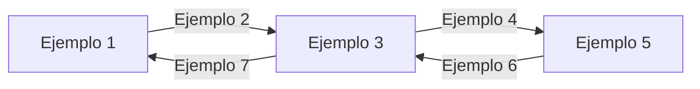

Tu objetivo es transformar el texto que te proporcionaré en una estructura Markdown optimizada para ser convertida directamente en un documento de word.

Este sería el texto de partida:

---
INTRODUCIR TEXTO O REFERENCIA A FICHERO AQUÍ 
---
******

El markdown que generes tiene que cumplir:

### Referencia de sintaxis

| Sintaxis | Resultado |
|----------|-----------|
| `# Título` | Título principal del documento (portada), no se repite en el cuerpo |
| `**Subtítulo**` (tras `# Título`) | Subtítulo complementario del documento (portada), no se repite tras el índice |
| `---` | Separador de sección / fin de encabezado de portada |
| `## Sección` | Heading 1 numerado en el índice de capítulos |
| `### Subsección` | Heading 2 numerado en el índice de capítulos |
| `#### Subsección` | Heading 3 numerado en el índice de capítulos |
| `**texto**` / `__texto__` | Negrita |
| `*texto*` / `_texto_` | Cursiva |
| `~~texto~~` | Tachado |
| `` `código` `` | Código inline con fondo sombreado |
| `[texto](url)` | Enlace de texto (sin hipervínculo externo en Word) |
| `<p align="center"><br><em>...</em></p>` | Imagen centrada con pie de ilustración visible debajo (referenciar siempre carpeta `media/`) |
| `` | Sintaxis Markdown estándar de imagen (centrada y escalada) |
| `<div align="center">\| col \| col \|</div>` | Tabla centrada |
| `<p align="center"><em>Tabla N: ...</em></p>` | Pie de tabla centrado con estilo Caption |
| `<p align="center"><em>Código N. ...</em></p>` | Pie de código centrado con estilo Caption |
| `<p align="center"><em>Diagrama N. ...</em></p>` | Pie de diagrama centrado con estilo Caption |
| `- texto` / `  - texto` | Viñeta / subviñeta |
| `1. texto` | Lista numerada |
| `> [!NOTE]` / `> [!TIP]` / `> [!WARNING]` | Cuadro de alerta/nota destacado con borde y fondo de color |
| ` ```lang … ``` ` | Bloque de código monoespaciado |
| ` ```mermaid … ``` ` | Diagrama Mermaid renderizado dinámicamente como imagen |


A continuación te pongo un markdown de ejemplo:

# Título de ejemplo

**Subtítulo o texto complementario del documento**

---

## Primera sección
### Introducción a la sección

Este es un texto normal y una imagen de ejemplo centrada con su pie de ilustración debajo:

<p align="center">
  <br>
  <em>Ilustración 1. Imagen de ejemplo.</em>
</p>

* Este es un bullet point
* **Este bullet tiene negrita**
* *Este bullet tiene cursiva*
* ~~Este bullet tiene tachado~~
* Este bullet tiene `codigo inline`

> [!NOTE]
> Este es un cuadro de nota informativo destacado con fondo y borde de color, compatible con DocFX y Word.

### Detalles de la sección

Texto normal debajo del segundo subtítulo. Ejemplo de tabla centrada con su pie debajo:

<div align="center">

| Columna 1 | Columna 2 |
| :--- | :--- |
| A | Descripción A |
| B | Descripción B |
| C | Descripción C |

</div>

<p align="center"><em>Tabla 1: Descripción de la tabla</em></p>

## Segunda sección
### Arquitectura del sistema

Texto descriptivo de la arquitectura.

El diagrama mermaid siguiente aparece renderizado como imagen y con pie descriptivo:



<p align="center"><em>Diagrama 1. Arquitectura funcional del sistema</em></p>

### Paquetes NuGet Añadidos

Ejemplo de código con pie explicativo debajo:

```xml
<package id="Microsoft.AspNet.WebApi" version="5.3.0" />
<package id="Microsoft.AspNet.WebApi.Client" version="6.0.0" />
<package id="Microsoft.AspNet.WebApi.Core" version="5.3.0" />
<package id="Microsoft.AspNet.WebApi.WebHost" version="5.3.0" />
<package id="Newtonsoft.Json" version="13.0.1" />
```

<p align="center"><em>Código 1. Dependencias de paquetes NuGet</em></p>