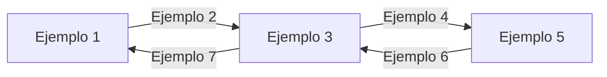

# Título de ejemplo

**Subtítulo o texto complementario del documento**

---

## Primera sección
### Introducción a la sección

Este es un texto normal y una imagen de ejemplo centrada con su pie de ilustración debajo:

<p align="center">
  <br>
  <em>Ilustración 1. Imagen de ejemplo.</em>
</p>

* Este es un bullet point
* **Este bullet tiene negrita**
* *Este bullet tiene cursiva*
* ~~Este bullet tiene tachado~~
* Este bullet tiene `codigo inline`

> [!NOTE]
> Este es un cuadro de nota informativo destacado con fondo y borde de color, compatible con DocFX y Word.

### Detalles de la sección

Texto normal debajo del segundo subtítulo. Ejemplo de tabla centrada con su pie debajo:

<div align="center">

| Columna 1 | Columna 2 |
| :--- | :--- |
| A | Descripción A |
| B | Descripción B |
| C | Descripción C |

</div>

<p align="center"><em>Tabla 1: Descripción de la tabla</em></p>

## Segunda sección
### Arquitectura del sistema

Texto descriptivo de la arquitectura.

El diagrama mermaid siguiente aparece renderizado como imagen y con pie descriptivo:



<p align="center"><em>Diagrama 1. Arquitectura funcional del sistema</em></p>

### Paquetes NuGet Añadidos

Ejemplo de código con pie explicativo debajo:

```xml
<package id="Microsoft.AspNet.WebApi" version="5.3.0" />
<package id="Microsoft.AspNet.WebApi.Client" version="6.0.0" />
<package id="Microsoft.AspNet.WebApi.Core" version="5.3.0" />
<package id="Microsoft.AspNet.WebApi.WebHost" version="5.3.0" />
<package id="Newtonsoft.Json" version="13.0.1" />
```

<p align="center"><em>Código 1. Dependencias de paquetes NuGet</em></p>
